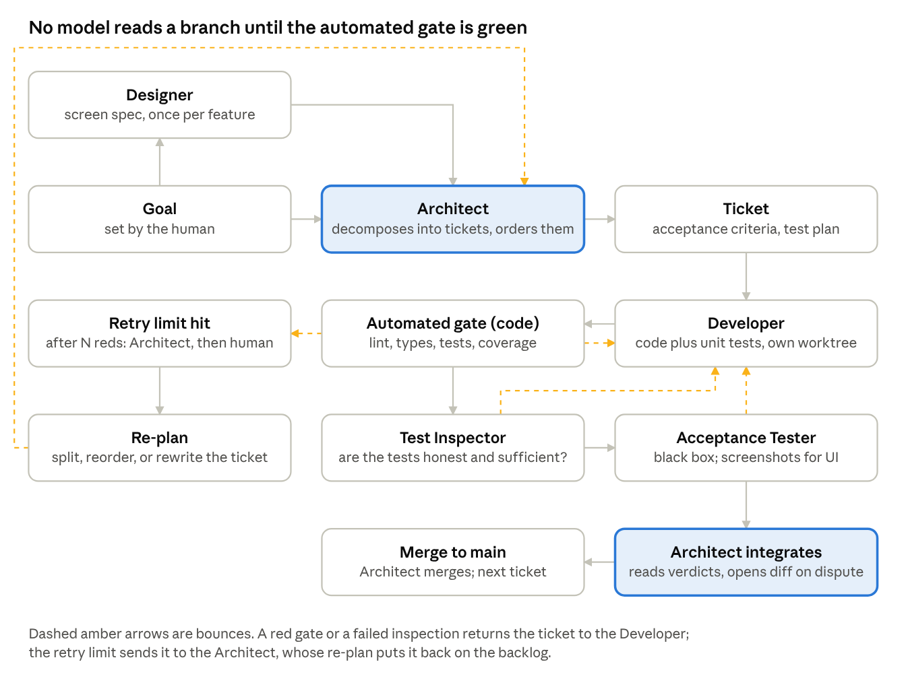

# Agentic Development Pipeline

As of 2026-11-03 · Josh Keal

## Goal and principles

The pipeline turns a stated goal into merged, tested code through a central Architect agent that writes tickets, downstream Developer agents that implement them, and Testing agents that inspect the result, with every ticket passing deterministic checks before any model reads it. It exists to build the Sealed Pool Analyzer, but nothing in it is specific to that app.

**What it optimizes for, in order:**

1. Goal fidelity. Every ticket traces to a goal, and a ticket is done only when its acceptance criteria pass, not when a developer agent says so.
2. Tokens spent only on judgment. Linting, type checks, unit tests, and coverage thresholds run as code and bounce failures straight back to the developer. A model inspects work only after the machine has nothing left to say about it.
3. Small, independent units of work. A ticket is sized so one agent can finish it in one session, with no questions back to the Architect, and so its tests can run in isolation.
4. Legibility for the human. The Architect's backlog, each ticket's history, and each gate's verdict are written down where a person can read them without reading the code.

**Principles every agent follows:**

- The ticket is the contract. A Developer agent implements what the ticket says and nothing more; scope creep is a ticket back to the Architect, not a bigger change.
- Tests first, in commit order (added 2026-11-03). For every criterion the ticket's test plan marks tests-first, the Developer commits a failing test before the code that makes it pass, in a separate commit, and the Test Inspector verifies the order from git history rather than reasoning about whether the test could fail. Criteria the plan marks as proven by a gate step or by the Acceptance Tester are exempt, so toolchain and wiring tickets carry no ceremony. A criterion the Developer cannot write a failing test for is bounced to the Architect before any code exists.
- Deterministic before probabilistic. No model reviews code that has not passed the automated gate. The gate's output is the first thing a Testing agent reads.
- One writer per set of files. Tickets that touch the same files are serialized by the Architect, never run in parallel.
- Bounded retries. Every stage has a retry limit, and hitting it escalates rather than loops.
- Nothing merges without a green gate and both Testing agent verdicts. The Architect merges; it does not skip steps to go faster.

**Standing authorizations.** Added 2026-11-03 after the first two goals asked the human to approve things the goal already settled. The human's approval of the pipeline, the design brief, and each goal's Decided list stands in advance. Pre-approved and never asked again: dispatching any wave of an open goal, merging on a green gate plus both verdicts, bounces and re-plans within limits, every default a goal states, criteria and splits derived from the goal, and pipeline-file commits straight to main. The human is asked once per topic, with options batched: design and visual choices (one review per feature), a new goal's open questions (one list, defaults applied to anything unanswered), an escalation after a limit, anything outside the repository, and a rule change. A pull request exists for code; one opened only to be approved is a sign the rule is being broken.

## Roles

One Architect, one Designer who writes the screen spec before UI tickets exist, as many Developers as there are independent tickets, two kinds of Testing agent, one automated gate that is code rather than a model, and one human. The gate sits between the Developer and every model that would otherwise read its work.

| Role | Kind | Owns | Reads | Produces | Runs |
| --- | --- | --- | --- | --- | --- |
| Human | Person | Goals, architecture decisions, answers to escalations | Backlog, ticket histories, escalations | Goals, approvals, answers to escalations | At goal definition and on escalation |
| Architect | Agent, one per project | The backlog: decomposing goals into tickets, ordering them, serializing tickets that touch the same files, integrating and merging finished work | Goals, the repository, gate verdicts, Testing agent verdicts, escalations | Tickets with acceptance criteria and a test plan, integration decisions, re-plans, questions to the human | Continuously: dispatches when a Developer is free, integrates when a ticket is verified |
| Designer | Agent, one per project | The design spec per feature: screen inventory, navigation flow, each screen's states (empty, loading, error, offline), the Compose component map, and an accessibility checklist | The goal, the existing design spec, the Architect's questions | A design spec the Architect cites in UI tickets, and the list of screens that get snapshot tests | Once per feature, before its tickets are written; never per ticket and never as a merge gate |
| Developer | Agent, one per ticket | One ticket in its own worktree and branch | Its ticket, the repository, the gate's output on its own runs | Code, the unit tests for that code, a branch that passes the gate, a short change note | Until the gate is green or the retry limit is hit |
| Automated gate | Code, not a model | Formatting, lint, type checks, unit tests, Compose UI tests, snapshot tests against stored baselines, coverage threshold, dependency audit | The branch | A machine-readable verdict: pass, or a failure list with file and line | On every Developer push, before any model sees the branch |
| Test Inspector | Agent, one per verified branch | Test adequacy: whether the tests prove the acceptance criteria rather than restate the code | Ticket, diff, gate output, the tests themselves | A verdict, plus any missing tests written and run, plus a bounce to the Developer when coverage is hollow | Only after a green gate |
| Acceptance Tester | Agent, one per verified branch | Black-box proof that the ticket's acceptance criteria hold; for UI tickets, a screenshot pass on an emulator against the design spec | Ticket, the built artifact, and the design spec for UI tickets; never the diff | A verdict with the exact command or scenario that failed, if any | After the Test Inspector passes; in parallel with it when the ticket says the two are independent |

**Why two Testing agents.** The Test Inspector reads the code and asks whether the tests are honest. The Acceptance Tester does not read the code and asks whether the ticket is done. A single agent doing both anchors on the implementation and passes tests that only prove what the developer already believed.

**Why a Designer, and why it is not a gate.** The app is used on a phone in a hurry, so screen design decides whether it works, and without a Designer the Architect invents layouts inside tickets. The Designer writes the spec once per feature, the way the format brief is written once per set. It never reviews merges: snapshot tests in the gate prove a screen is unchanged for free, and the Acceptance Tester's screenshot pass catches a screen that drifted from the spec.

**Why the Architect does not review code line by line.** It reads verdicts, not diffs, and opens a diff only when verdicts disagree or an escalation names it. That keeps the most expensive agent's tokens on planning and integration.

## Ticket lifecycle

A ticket flows Architect to Developer to gate; a red gate or a failed inspection bounces it to the Developer without a model reading it; only a green branch reaches the two Testing agents, after which the Architect integrates on their verdicts, and exhausted retries climb to the Architect's re-plan.

## Ticket contract

A ticket is a file in the repository, written by the Architect, that a Developer agent can implement with no questions back. If a Developer has to ask, the ticket was wrong and goes back to the Architect as a bounce, not as a chat.

| Field | What it holds | Who fills it |
| --- | --- | --- |
| `id` | Short stable key, e.g. `SPA-014` | Architect |
| `goal` | The goal this ticket serves, by id, and the one sentence of that goal it advances | Architect |
| `title` | One line, imperative: "Parse a ManaBox CSV into a Pool" | Architect |
| `scope` | What changes, as a list of files or modules expected to be touched, and an explicit "not in scope" list | Architect |
| `design_ref` | For UI tickets, the design spec section and screen names this ticket implements | Architect, from the Designer's spec |
| `acceptance_criteria` | Numbered, each one checkable by a command or a scenario, none of them "works correctly" | Architect |
| `test_plan` | Which criteria get unit tests, which get Compose UI or snapshot tests, which need the Acceptance Tester, and which cannot be tested automatically and why | Architect drafts; Developer may add, never remove |
| `depends_on` | Ticket ids that must merge first | Architect |
| `serialize_with` | Tickets that touch the same files and therefore never run at the same time | Architect |
| `budget` | Token and wall-clock budget for the Developer, and the retry limit for each stage | Architect, from the defaults in the next section |
| `status` | `queued`, `in_progress`, `gate_red`, `inspecting`, `accepted`, `integrated`, `escalated` | The pipeline, never an agent by hand |
| `history` | Append-only log: every gate run with its verdict, every inspector verdict, every bounce with its reason, every retry count | The pipeline |
| `change_note` | Three to five lines from the Developer: what changed, what it chose not to do, anything the next ticket should know | Developer |

**Sizing rule.** A ticket is small enough when one Developer can finish it in one session and its tests run in isolation. A ticket that needs two sessions is two tickets. The Architect splits before dispatch, not after a bounce.

**Acceptance criteria are the whole contract.** The Test Inspector checks that the tests prove the criteria; the Acceptance Tester checks the criteria directly; the Architect integrates when both say the criteria hold. Nothing else about the code is judged, so anything that matters must be a criterion.

## Gating rules and token economy

The rule is simple: a model reads a branch only after the gate has nothing left to say about it, and every model stage has a budget it cannot exceed.

**What the gate runs, in order, stopping at the first failure:**

1. Formatter check. A formatting diff is a red gate, because it is free to fix and it hides real changes in review.
2. Lint and static analysis, including the accessibility lint for Compose screens.
3. Type check and compile.
4. Unit tests for the whole module, not just the files the ticket touched.
5. Compose UI tests and snapshot tests for the screens the ticket's `test_plan` names. A snapshot that differs from its stored baseline is red unless the ticket updates the baseline on purpose and says so in the change note.
6. Coverage threshold on the files the ticket touched. The threshold is per ticket, set by the Architect from the test plan, and never lowered by a Developer.
7. Dependency audit: no new dependency the ticket did not name in `scope`.

The gate writes one machine-readable verdict to the ticket's history: pass, or a list of failures with file, line, and the exact command that reproduces each. A Developer reads that list and nothing else.

**What a model never does:**

- Review a branch with a red gate.
- Re-run the gate by hand to see if it passes this time. The gate is deterministic; a flaky test is a ticket.
- Read the whole repository to find the problem. The verdict names the file and line.

**Budgets and limits, as starting defaults for the Architect to tune per ticket:**

| Stage | Retry limit | Budget per attempt | On limit |
| --- | --- | --- | --- |
| Developer, gate red | 3 attempts | One session, token budget set by ticket size | Escalate to Architect with the gate history |
| Test Inspector bounce | 2 bounces | One inspection pass | Escalate to Architect: the ticket's test plan was likely wrong |
| Acceptance Tester bounce | 2 bounces | One acceptance pass | Escalate to Architect: a criterion is likely untestable or ambiguous |
| Architect re-plan | 2 re-plans per ticket | One planning pass | Escalate to the human with the full history |
| Any ticket, wall clock | n/a | A ceiling the Architect sets at dispatch | Mark `escalated`; the human decides |

**Where the tokens go, by design.** The Developer spends the most per ticket, and the gate makes sure those tokens are spent on code, not on reading review comments about formatting. The Testing agents spend a bounded amount per branch because they read a diff and a verdict, not a repository. The Architect spends on planning and integration; it reads diffs only on disputes. A ticket that bounces three times has already cost more than a well-written ticket would have, which is why the retry limit escalates to the Architect rather than letting the Developer keep trying.

## Feedback loops

Every failure goes somewhere specific, carries its reason, and counts against a limit. Nothing loops silently.

**Bounces** go to the Developer and carry one thing: the gate's failure list, or the inspector's verdict with the criterion it failed. The Developer's next attempt starts from the branch as it stands plus that reason. A bounce never carries advice about how to fix it; the Developer has the ticket and the failure, and that is the contract.

**Escalations** go up one level at a time:

1. Developer to Architect, when the retry limit is hit. The Architect reads the ticket history, not the code, and decides: split the ticket, rewrite a criterion, change the test plan, or reorder so a dependency lands first. That is a re-plan, and it counts against the ticket's re-plan limit.
2. Testing agent to Architect, when a bounce limit is hit. Two failed inspections in a row usually mean the test plan or a criterion was wrong, not the code.
3. Architect to human, when the re-plan limit is hit or when two agents' verdicts contradict each other and the Architect cannot settle it from the diff. The human gets the full history and a one-paragraph summary, and answers with a decision, not a code change.

**Re-plans** are the Architect changing its own earlier work. They are recorded on the ticket and on the goal, so a goal that keeps producing re-plans is visible as a planning problem rather than a developer problem.

**What the pipeline learns between tickets:**

- The Architect keeps a short lessons file in the repository: criteria that turned out untestable, splits that worked, gate failures that recur. It reads that file before writing the next ticket.
- A test that fails intermittently becomes its own ticket to fix or delete. It never becomes a retry.
- A gate failure category that appears on three tickets in a row (formatting, a lint rule, a missing dependency declaration) becomes a change to the ticket template or the Developer's instructions, so it stops recurring.
- The Designer's spec is updated when an Acceptance Tester screenshot pass reveals a state the spec never described. The spec gains the state; the ticket does not merge until the screen matches the updated spec.

**Human overrides** are allowed at any point and are logged like any other event. Overriding a red gate to merge is the one override the pipeline refuses; the human can change the gate's rules, but not skip them for one branch.

## Tooling

The roles map onto things that already exist: Claude Code sessions for the agents, git worktrees for isolation, a pre-push hook plus continuous integration for the gate, and pull requests as the unit the human approves. Nothing here needs a custom orchestration server for the first goal.

| Role or artifact | Runs as | Notes |
| --- | --- | --- |
| Tickets, goals, lessons | Markdown files with a small front matter block, in a `tickets/` folder of the code repository | Versioned with the code, readable by a person, diffable; status changes are commits the pipeline makes, never hand edits |
| Design spec | A markdown file per feature under `design/`, written by the Designer, cited by ticket `design_ref` | Lives beside the code so a Developer reads it from the worktree |
| Architect | One long-lived Claude Code session in the repository root | Dispatches by starting a Developer session per ticket; reads ticket history and verdicts; opens a diff only on dispute |
| Designer | A Claude Code session started by the Architect once per feature, before that feature's tickets | Writes the spec and the snapshot-test screen list, then ends |
| Developer | A Claude Code session in its own git worktree and branch, one per ticket, started by the Architect with the ticket as its brief | Runs the gate locally before pushing; ends when the gate is green or the retry limit is hit |
| Automated gate | A script the repository owns, run by a pre-push hook locally and by continuous integration on every push | Same script in both places, so a Developer never sees a CI failure the local run would not have shown. For the Android app: formatter and lint, Kotlin compile, JVM unit tests, Compose UI tests, snapshot tests with a library such as Paparazzi, coverage on touched files |
| Test Inspector, Acceptance Tester | Subagents or sessions the Architect starts only after CI reports green on the ticket's pull request | They receive the ticket, the gate verdict, and the pull request; the Acceptance Tester also gets an emulator and the design spec for UI tickets, and is told not to read the diff |
| Pull request | One per ticket, opened by the Developer, carrying the ticket id and the change note | CI green plus both Testing agent verdicts are required checks; the Architect merges when they pass, and the human reads merges in the ticket history |
| Escalation to human | A comment on the pull request from the Architect, plus a note in the ticket history | The human answers in the ticket, and the Architect resumes |

**Why worktrees and one Developer per ticket.** Two agents editing the same checkout overwrite each other with no warning. A worktree per ticket makes the one-writer rule physical, and `serialize_with` on the ticket keeps two worktrees from touching the same files in the same window.

**Model choice per role** is a budget decision, not a design one: the Architect and Designer do the judgment-heavy work and get the most capable model; Developers and Testing agents can run on a cheaper model once the gate and the ticket contract are doing their jobs, and the metrics below show whether that holds.

## Metrics

The pipeline is working when tickets merge on the first pass and tokens go to Developers writing code, not to models re-reading failures. Every metric below comes from the ticket history files, so none of them needs extra instrumentation.

| Metric | What it tells you | Healthy looks like |
| --- | --- | --- |
| Gate green on first push | Whether Developers are writing and running tests before pushing | Rising over the first ten tickets, then high and stable |
| Bounces per merged ticket, by source (gate, Test Inspector, Acceptance Tester) | Which stage is catching problems, and therefore which earlier stage is letting them through | Gate catches most; inspectors rarely bounce; a rising inspector share means the gate is missing a check |
| Tokens per merged ticket, by role | Where the money goes and whether the gate is saving it | Developer share largest; Architect and Testing agents bounded; total falling as the ticket template improves |
| Re-plans per goal | Whether the Architect is writing tickets that can be implemented as written | Near zero after the first goal |
| Escalations to human per goal | How often the pipeline cannot finish on its own | A few per goal early, trending to zero |
| Lead time per ticket, dispatch to merge | Throughput, and whether serialization is starving the queue | Stable; a jump points at `serialize_with` or a flaky gate |
| Criteria covered by deterministic tests | How much of each ticket is proven by code rather than by a model | Rising; anything the Acceptance Tester alone proves is a candidate for a new automated check |

Report these per goal, once the goal closes, in a short table appended to the goal file. The first goal's numbers are the baseline; the second goal's numbers are the first real evidence.

## Decisions

All nine were settled on 2026-11-03: the Architect merges, and every other default below was confirmed as written.

- [x] Who merges? Decided 2026-11-03: the Architect merges, once CI is green and both Testing agent verdicts pass. The human is not a merge step; every merge is visible in the ticket history and the goal file, and the human's hand is on goals and escalations.
- [x] How many Developers at once? Default: as many as there are tickets with no `serialize_with` conflict, capped at three so the human can follow along. Alternative: one at a time for the first goal.
- [x] Where do tickets live? Default: markdown files in the code repository. Alternative: GitHub issues, which gives a board for free but moves the contract out of the worktree.
- [x] Retry and bounce limits. Default: 3 Developer attempts, 2 inspector bounces, 2 re-plans, as in the gating table. Lower for the first goal if you want to see escalations early.
- [x] Local gate or CI only? Default: both, same script. The local pre-push run is what keeps a Developer from spending a CI round trip on a formatting error.
- [x] Which model per role? Default: most capable model for Architect and Designer, a cheaper model for Developers and Testing agents, revisited after the first goal's token numbers.
- [x] Where does the design spec live? Default: in the code repository beside the tickets. Alternative: in this design-doc repository, which keeps design and code apart but means a Developer reads it from outside its worktree.
- [x] First goal to run through the pipeline. Default: the Foundation phase of the Sealed Pool Analyzer (card data, format brief, ManaBox intake, metric engine), because it has no UI and so exercises everything except the Designer.
- [x] Where does the pipeline's own code live? The gate script, the ticket template, and the agent instructions need a home. Default: the code repository, so the pipeline ships with the code it tests.

Living copy of this document: https://claude.ai/artifact/R5YDvfq8ESwVED88DXdFHd
