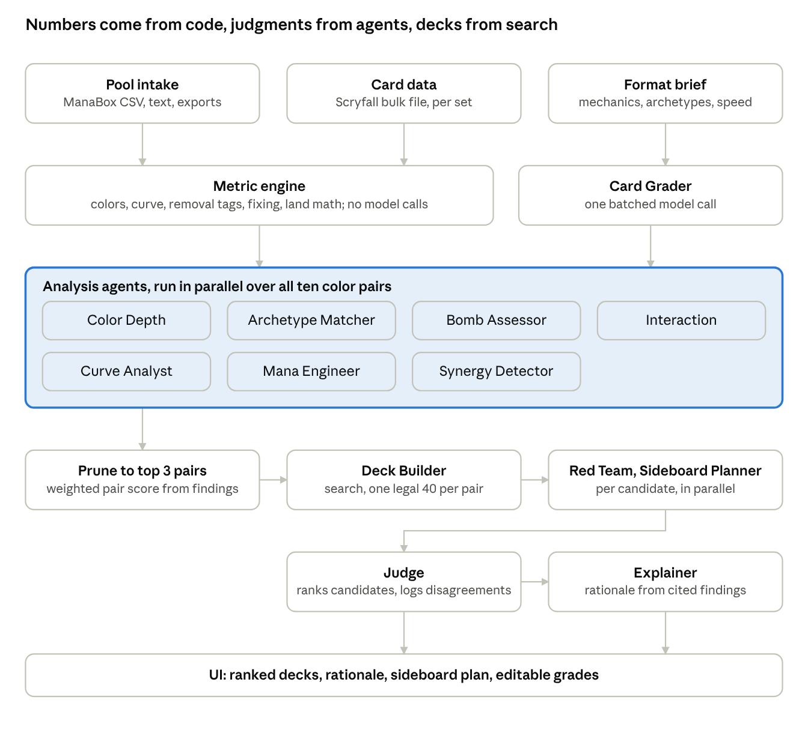
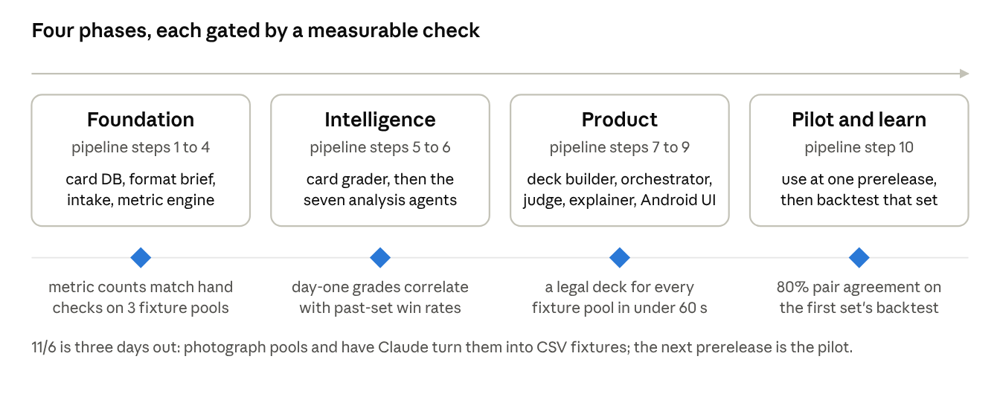

# Sealed Pool Analyzer Design Brief

As of 2026-11-03 · Josh Keal

## Overview

The Sealed Pool Analyzer takes the 85 or so cards a player opens at a Magic: The Gathering prerelease and returns two or three ranked 40-card deck candidates, each with a written rationale, a land count, and a sideboard plan. It exists because a prerelease player has about 30 minutes to evaluate a set they have never played with, and most of them default to "my two colors with the most rares" without checking curve, removal count, or whether a splash is safe.

**Who it is for.** Primarily casual-to-intermediate prerelease players building at the table. A secondary audience is content creators and judges who want a consistent second opinion on a pool. A longer-term audience is competitive players who want the backtesting data (see Evaluation and testing).

**What it is not.** It is not a draft tool, a constructed deck builder, or a collection manager. The pool is fixed, the card count is small, and the deadline is minutes, so every design choice favors speed and legibility over completeness.

**Success looks like:**

- A pool entered from a ManaBox export in seconds, or as text in under two minutes, and ranked deck candidates back in under one.
- The top recommended color pair matches what a strong player would pick on at least 80% of pools, measured against historical sealed data after a set releases.
- Every recommendation is explainable in plain language: why this pair, why these 23 cards, why 17 lands, and what to swap in from the sideboard against each generic opponent archetype (aggro is one example, not the only case).
- The system works on prerelease day for a brand-new set, before any community win-rate data exists. This constraint drives most of the agent design below.

## Domain constraints

Sealed is a fixed-pool, two-color, 40-card format, and the app should encode those rules as hard constraints rather than rediscover them with an LLM each time.

**What a prerelease kit contains.** A standard kit holds six Play Boosters of the new set plus one foil promo-stamped rare or mythic from the set. Each Play Booster has 14 cards: roughly six or seven commons, three uncommons, one rare or mythic, one land slot, one non-foil wildcard slot of any rarity, and one traditional-foil wildcard slot, plus a token or art card that is not playable. The pool is therefore about 85 playable cards, of which six to nine are rares or mythics. Some Universes Beyond and special sets change the kit, so the kit template must be a per-set configuration, not a hardcoded assumption.

**Deck rules the builder must enforce:**

- Minimum 40 cards in the main deck. In practice exactly 40.
- Unlimited basic lands are supplied by the store. Only basics are free; nonbasic lands must come from the pool.
- Every card not in the main deck is the sideboard. Players may rebuild the deck entirely between games of a match, so a sideboard plan is meaningful and worth generating.
- The pool is the pool. There is no trading, drafting, or signal reading, so the only decision is which subset of the 85 cards to play and how many lands to add.

**Heuristics that hold across nearly every set, and which the metric layer should encode as defaults the agents can override:**

- Two or three colors is the baseline. With little fixing, the third color is a splash of one to three cards, usually removal or a bomb, and needs at least two or three fixing sources to be safe. With reliable, accessible fixing (dual lands, mana rocks, treasure makers, land-fetching creatures), running the best cards from four or even five colors becomes a legitimate build, and the Mana Engineer decides when the pool crosses that threshold.
- 17 lands and 23 spells is the standard. 16 lands fits a low curve with a 2-drop-heavy deck. 18 fits a top-heavy deck with mana sinks.
- Roughly 15 to 17 creatures, a curve centered on two and three mana, and at least three or four pieces of removal or interaction.
- Sealed is slower than draft. Bombs and card advantage matter more, aggressive 2-drops matter less, and games go long enough that a single mythic can decide them.

**What changes per set, and therefore must be learned, not assumed:**

- The set's mechanics and keywords, and how they interact.
- The ten two-color archetypes the set is designed around, usually signposted by gold uncommons. These sit alongside the generic limited archetypes that exist in every format (aggro, midrange, control, tempo, evasion or flyers, go-wide tokens, ramp into big threats), and the format brief lists both so agents can describe a pool, and an opponent, in either vocabulary.
- The format speed. Some sets reward aggression; most prerelease formats reward durable creatures and removal.
- Which commons are the premium removal and which rares are the true bombs. This is the hardest problem on prerelease day because no play data exists yet.

**Why sealed differs from draft and constructed.** Draft tools optimize pick order under uncertainty about future cards. Constructed tools search a huge card space for a metagame. Sealed has neither problem: the card space is 85 cards, the search space of legal decks is small enough to enumerate heavily, and the real difficulty is card evaluation for an unfamiliar set. That is why this design puts most of the intelligence into evaluation agents and treats deck construction as a constrained search problem.

## System architecture

The pool and the per-set data feed a deterministic metric engine; the analysis agents interpret those numbers in parallel; a search builds one deck per surviving color pair; and the Judge ranks the candidates before the Explainer writes them up.

## Development pipeline

Build the deterministic layers first and the LLM agents last, so that every agent reasons over verified numbers instead of raw card lists. Each phase below is independently testable and shippable.

1. **Card data foundation.** Load Scryfall bulk data into a local database keyed by set code, with a normalized card model that handles double-faced cards, adventures, split cards, and the kit's promo variants. Tag each card with color identity, mana value, type line, rarity, and parsed keywords.
   - Delivers: a `cards` store and a `get_set(set_code)` query that returns every card legal in that set's sealed pool.
   - Verified by: unit tests on the awkward card types, and a row count that matches Scryfall's set size.
2. **Format brief ingestion.** Before each prerelease, assemble a per-set brief: mechanics with rules text, the ten archetypes and their signpost uncommons, the kit template, and any available community set-review grades. Store it as structured data the agents read, not as a prompt someone retypes.
   - Delivers: a `format_brief` record per set, plus a script that drafts one from Scryfall data and release notes for a human to review.
   - Verified by: a checklist review against the set's release notes, done once per set.
3. **Pool ingestion.** Parse a pool from a ManaBox CSV export, from plain text (one card name per line, with counts), from an Arena or MTGO export, and from a list of collector numbers. ManaBox is the primary path: it scans cards with the phone camera, and its export carries a Scryfall ID per row, so those pools resolve exactly with no fuzzy matching. The app registers as an Android share target for CSV files so a ManaBox export opens in it directly, and any CSV in that format works, including one Claude writes from photos of the pool. Resolve names fuzzily against the set, flag anything unresolved, and validate the pool shape against the kit template. Photo and OCR capture is a later addition.
   - Delivers: a `Pool` object of resolved card references with quantities.
   - Verified by: a fixture set of 20 real pools, at least five of them ManaBox exports, including misspellings and double-faced card names, all resolving with zero silent errors.
4. **Metric engine.** Deterministic, LLM-free analytics over a pool: cards per color, playables per color by rarity, mana curve per color pair, creature counts, removal and interaction tags via rules-text patterns, fixing sources, splash candidates, and hypergeometric land math. Every number is reported next to a set baseline: the same metric for a typical pool from this set, computed by simulating thousands of kits from the set's rarity and slot distribution. An agent then sees that four removal spells is above or below average for this event, not a bare count, and the pool is weighed against the set it came from. This is the layer every agent consumes.
   - Delivers: a `PoolMetrics` object and a `ColorPairMetrics` object for each of the ten pairs.
   - Verified by: golden-file tests on the fixture pools and hand-checked numbers for three of them.
5. **Card grading layer.** A per-card limited grade on a shared scale, relative to this set rather than to Magic as a whole so a card is judged against what it will actually face at the event, assembled from whichever sources exist: community win-rate data when the set is already on Arena, published set-review grades when available, and an LLM heuristic grade from rules text and the format brief as the fallback that always exists. Every grade carries its source and a confidence.
   - Delivers: a `grade(card, set)` function returning score, confidence, and provenance.
   - Verified by: rank correlation against 17Lands game-in-hand win rates for three past sets where the LLM grade is run blind.
6. **Analysis agents.** The specialist agents described in the next section, each reading the pool, the metrics, and the grades, and each returning structured findings with cited card names. Built one at a time against the fixture pools.
   - Delivers: one agent module per specialty with a shared output schema.
   - Verified by: schema validation on every run and a human spot-check of findings on five pools per agent.
7. **Deck construction.** A constrained search that, for a given color pair and optional splash, selects 22 or 23 spells and a land configuration to maximize a composite score built from grades, curve shape, creature count, and interaction count. Greedy fill plus local swaps is enough at this card count.
   - Delivers: a `build(pool, pair, splash)` function returning a legal 40-card deck and the unused cards as a sideboard.
   - Verified by: legality checks on every output and a comparison against the decks strong players actually registered for the same pools.
8. **Orchestration and synthesis.** Run the agents, reconcile their findings, pick the two or three color pairs worth building, call the builder for each, then have a judge agent rank the candidates and an explainer write the rationale and sideboard plan.
   - Delivers: an end-to-end `analyze(pool)` call returning ranked `DeckCandidate` objects with narrative.
   - Verified by: end-to-end latency under 60 seconds and the color-pair agreement metric from the Evaluation section.
9. **Interface.** An Android app with a pool entry screen, a metrics dashboard, ranked candidates, and a per-card drill-down showing which agent said what. Native Android, because it is used on a phone at a table in a game store, and the camera makes photo capture a natural later addition.
   - Delivers: a usable product for one set.
   - Verified by: five people building real pools with it at a prerelease.
10. **Backtesting and feedback loop.** After each set releases, pull public sealed game data, replay historical pools through the system, and score the recommendations. Let users record their match results in the app so the grading layer can learn from them.
    - Delivers: a backtest report per set and a results table that feeds the grading layer.
    - Verified by: the color-pair agreement metric improving set over set.

Phases 1 through 4 need no LLM calls and can be built in any language with a solid test harness. Phase 5 onward uses the Claude API with structured outputs. The split matters for cost and determinism: the metric engine runs on every keystroke in the UI, while the agents run once per analysis.

## Agent roster

Fifteen agents, grouped into four tiers: intake, analysis, construction, and judgment. The analysis tier runs in parallel; everything else is sequential. Confidence describes how much to trust the agent's output on prerelease day for a brand-new set, before any play data exists.

| Agent | Tier | Question it answers | Reads | Produces | Day-one confidence |
| --- | --- | --- | --- | --- | --- |
| Intake | Intake | What cards are actually in this pool? | ManaBox CSV, pasted text, Arena or MTGO export, or OCR output; set card list | Resolved `Pool` with quantities and a list of unresolved lines | High (deterministic with fuzzy matching; LLM only for OCR cleanup) |
| Format Scout | Intake (once per set) | What does this set reward? | Scryfall set data, release notes, published set reviews | `format_brief`: mechanics, ten designed archetypes with signposts, the generic archetypes (aggro, midrange, control, tempo, flyers, go-wide, ramp), expected format speed, premium commons | Medium (human reviews it once per set) |
| Card Grader | Analysis | How good is each card in this format? | Rules text, rarity, the set baseline, `format_brief`, community win rates when they exist | Per-card grade on a shared scale with confidence and source | Low to medium day one; high once 17Lands data exists |
| Color Depth Analyst | Analysis | Which colors are deep enough to play? | `PoolMetrics`, card grades | Per-color playable count, quality-weighted depth score, thin-color warnings, each compared with the set baseline | High |
| Archetype Matcher | Analysis | Which of the set's archetypes does this pool support? | `format_brief`, pool, grades | Per-pair archetype fit score, signpost uncommons present, missing pieces | Medium |
| Bomb Assessor | Analysis | Which cards win games on their own, and do they justify a color commitment or splash? | Rares and mythics, grades, `format_brief` | Ranked bomb list with a build-around flag and splash cost | Medium |
| Interaction Analyst | Analysis | How much removal and interaction is here, and what does it answer? | Rules-text tags, grades, format threat profile | Per-pair removal count by type (hard, conditional, combat trick, counter), reach assessment, each count compared with the set baseline | High for counting, medium for quality |
| Curve Analyst | Analysis | Does each pair have a playable curve and enough creatures? | `ColorPairMetrics` | Per-pair curve histogram, creature count, 2-drop count, top-end weight, flagged gaps | High |
| Mana Engineer | Analysis | How many lands, and is a splash safe? | Pair composition, fixing sources, splash candidates | Land count recommendation, color source counts, hypergeometric odds of casting each splash card on curve | High |
| Synergy Detector | Analysis | Which mechanics and tribes have both enablers and payoffs here? | Parsed keywords, creature types, `format_brief` | Synergy clusters with enabler and payoff counts, strength rating | Medium |
| Deck Builder | Construction | What is the best legal 40 for this pair? | All analysis outputs for one pair, pool | A `DeckCandidate`: 22 or 23 spells, lands, sideboard, composite score | High for legality, medium for optimality |
| Red Team | Judgment | What is wrong with this deck? | One `DeckCandidate`, the full pool, format threat profile | Weakness list, cards left in the sideboard that may be better, matchups it loses | Medium |
| Sideboard Planner | Judgment | What changes between games against each kind of opponent? | `DeckCandidate`, sideboard, Red Team findings | Swap plans for each generic opponent archetype: aggro, midrange, control, tempo, flyers, go-wide, and artifact or enchantment-heavy decks | Medium |
| Judge | Judgment | Which candidate should the player register? | All candidates, all agent findings, Red Team reports | Ranked candidates with a one-line verdict each and the disagreements it resolved | Medium |
| Explainer | Judgment | Why? | Judge ranking, every agent's cited findings | Plain-language rationale per candidate, card-by-card notes, land count justification | High (it only restates cited findings) |

**Design rules that apply to every agent:**

- Every finding cites specific card names from the pool. A finding that names no card is dropped before it reaches the Judge.
- Every agent returns a fixed JSON schema with a `confidence` field. The Judge weights findings by that field and by the tier's day-one confidence above.
- Analysis agents never see other agents' output. That keeps them independent so the Judge sees genuine disagreement rather than anchoring.
- The Card Grader is the single biggest risk to recommendation quality. Its grades should be visible and editable in the UI so a player who knows the format can correct them and rerun.
- Agents that answer deterministic questions (Color Depth, Curve, Mana Engineer, Interaction counting) should be thin wrappers over the metric engine that only add interpretation. The number comes from code, the sentence comes from the model.

## Orchestration

One orchestrator runs the pipeline as fan-out, prune, build, fan-out, judge. The whole run should finish in under 60 seconds, which means the ten color pairs are pruned to three before any deck is built.

**Shared state.** Every agent receives the same immutable bundle: the resolved `Pool`, the `PoolMetrics` and ten `ColorPairMetrics` objects, the per-card grades, and the `format_brief`. Agents write findings to a shared `findings` list keyed by agent name and color pair. Nothing is passed agent to agent except through that list, and only the Judge, Red Team, Sideboard Planner, and Explainer read it.

**Run order:**

1. Intake resolves the pool. Unresolved lines stop the run and go back to the user; a pool that does not match the kit template produces a warning but continues.
2. The metric engine computes all metrics synchronously. No model calls yet.
3. The Card Grader runs once over all 85 cards in a single batched call, returning grades and confidence.
4. The seven analysis agents run in parallel, each over all ten color pairs, each returning per-pair findings. Parallelism here is what keeps latency acceptable.
5. The orchestrator computes a provisional pair score from the findings: quality-weighted depth, archetype fit, bomb presence, removal count, and curve health, with weights from the `format_brief`. It keeps the top three pairs, and adds a fourth if a splash candidate changes the picture for a pair just outside the cut.
6. The Deck Builder runs for each surviving pair. This is search, not a model call, and returns one candidate per pair plus a second variant when a splash is viable.
7. Red Team and Sideboard Planner run in parallel over each candidate.
8. The Judge ranks the candidates and the Explainer writes the rationale for each.

**Resolving disagreement.** Agents will disagree: the Bomb Assessor wants green for a mythic while the Curve Analyst flags green as having two playable 2-drops. The orchestrator does not average these away. It passes both findings, with their confidence, to the Judge, whose output schema requires a `disagreements_resolved` field listing each conflict and the reason for the call. That field goes straight into the UI, because the conflicts are usually the most useful thing to show a player.

**Failure handling.** An analysis agent that times out or returns an invalid schema is dropped for that run and the Judge is told it is missing. The run completes on the metric engine's numbers alone if every agent fails, so the user always gets a legal deck with a land count, just without narrative.

**Reruns.** The user can edit any card grade, pin a card into or out of the main deck, or force a color pair. A rerun skips Intake and the Card Grader and starts at step 4 with the overrides applied, so reruns take a fraction of the first run.

## Data sources and dependencies

Two sources are enough for a working product: Scryfall for card data and 17Lands for play data. Everything else is optional enrichment. The figures and terms below are from memory and should be confirmed against each source's current terms before building.

| Source | What it provides | Available on prerelease day? | Access and licensing notes |
| --- | --- | --- | --- |
| [Scryfall](https://scryfall.com/docs/api) | Every card's rules text, mana cost, types, rarity, color identity, set membership, images, and collector numbers, as a free bulk JSON download and a REST API | Yes. New sets appear during preview season, before release | Free. Card text and images are Wizards of the Coast property; Scryfall's terms require attribution and prohibit using their data to build a paid competing card database. Cache the bulk file locally and refresh daily during preview season |
| [17Lands](https://www.17lands.com/public_datasets) | Public game-level datasets from Arena, including sealed, with per-card win-rate metrics such as game-in-hand win rate and opening-hand win rate | No. Data accumulates after the set hits Arena, usually around official release, a week after prerelease | Free for non-commercial use. This is the backbone of the backtesting plan and of card grading for any set older than a few weeks |
| Published set reviews | Human limited grades per card from established content creators, released during preview season | Usually, for the big outlets | Copyrighted editorial content. Use as a cross-check for the Card Grader's output during development, not as a shipped data source |
| Wizards release notes | Authoritative rules text for new mechanics and the designed archetypes | Yes, published a week or more before prerelease | Free to read. The Format Scout drafts the `format_brief` from these; a human confirms it |
| ManaBox, MTG Arena, and MTGO export formats | The formats players already have their cards in: ManaBox's CSV (name, set code, collector number, quantity, foil, and Scryfall ID among its columns; confirm against a real export) and the Arena and MTGO decklist text | Yes | CSV and plain text. ManaBox scans cards by camera, so its export is the fastest way to get an 85-card pool into the app and stands in for native photo capture; Arena and MTGO exports help people who type pools into Arena first |
| [Claude API](https://docs.anthropic.com) | The reasoning behind every agent, with structured outputs for the fixed schemas and prompt caching for the shared pool bundle | Yes | Metered, billed to an API key. Each user supplies their own key from the Claude Console; Anthropic's terms restrict claude.ai subscription logins to Claude Code and claude.ai, so the app cannot bill a user's subscription. Batch the Card Grader into one call per pool, cache the pool bundle across the parallel agents, and keep the metric engine LLM-free so the UI can be free to use before the user runs a full analysis |

**Runtime dependencies worth deciding early:**

- A local database for cards and pools. SQLite on the device (Room on Android) holds the set's cards, the user's pools, and recorded results; nothing in the MVP needs a server database.
- A fuzzy string matcher for Intake. Card names in a new set are unfamiliar to spell checkers and to players, so the matcher should be restricted to the set's card list, which makes it both faster and more accurate.
- An OCR path for photo capture, if that feature ships. A vision model call on a photo of fanned cards is simpler than a dedicated OCR pipeline and is the likely first implementation.

## Evaluation and testing

The system is good if its top recommendation agrees with what strong players actually built, and the public sealed datasets let that be measured for free after every set.

**Backtest protocol, run once per set after play data exists:**

1. Pull the set's sealed game data and reconstruct each player's pool and registered deck.
2. Keep only players above a win-rate threshold, so the comparison target is strong play rather than average play.
3. Run each pool through the analyzer with the Card Grader forced into day-one mode, meaning no win-rate data, so the test reflects prerelease conditions.
4. Score the output on the metrics below.

**Metrics, from coarsest to finest:**

- Color-pair agreement: the analyzer's top pair matches the strong player's pair. Target 80%. Also report whether the player's pair was in the analyzer's top three, which should be above 95%.
- Main-deck overlap: of the 23 spells the player registered, how many are in the analyzer's top candidate. Target 18 or more on average.
- Land count agreement: within one land of what the player ran.
- Grade correlation: Spearman correlation between the day-one Card Grader and the eventual game-in-hand win rate. This isolates the hardest component and tracks whether prompt or data changes to the grader help.
- Predicted win rate: the average actual win rate of the decks the analyzer would have built, estimated by matching card-level win rates. This is noisy but is the number players care about.

**Tests below the backtest:**

- Golden-file tests for the metric engine on fixture pools, so a refactor cannot silently change a curve count.
- Schema tests on every agent output, run against recorded model responses so the suite is fast and deterministic.
- Legality tests on every deck the builder emits: exactly 40 cards, only pool cards plus basics, no card exceeding its pool quantity.
- Latency tests on the end-to-end run against the 60-second budget.

**Live evaluation.** Let users record their match record after the event and which candidate they played. A few hundred results per set is enough to see whether the top candidate outperforms the second and third, which is the only direct measure of whether the Judge is ranking well.

## Risks and decisions

The single largest risk is card grading on day one, and the mitigation is to make grades visible, editable, and measured. Every product decision below was settled on 2026-11-03.

**Risks:**

- Day-one card grades are wrong for a new set. Mitigation: show the grade and its source on every card, let users override, and backtest the grader against every set so prompt changes are measured rather than guessed.
- Agents hallucinate interactions that do not exist, such as a keyword the set does not have. Mitigation: the `format_brief` is the only source of mechanic definitions the agents see, and every finding must cite pool card names that the orchestrator checks against the pool.
- Latency at the table. Fifteen agents sequentially would take minutes. Mitigation: the parallel analysis tier, pruning to three pairs before building, and prompt caching of the shared bundle.
- Cost per analysis. Mitigation: the metric engine is free and instant, so a user gets most of the value before spending a model call; agent calls run on the user's own API key, so the author carries no per-run cost; batch the grader; measure cost per run from the first prototype so users can be told what an analysis costs them.
- Intake friction kills adoption. Typing 85 unfamiliar card names is the worst part of the experience. Mitigation: ManaBox CSV import first (its camera scan plus Scryfall IDs covers photo capture for now), then set-restricted fuzzy matching and collector-number entry, with native photo capture after the pilot.
- Licensing. Card text and images belong to Wizards of the Coast, and 17Lands data is non-commercial. Mitigation: the tool is free and non-commercial, which keeps it inside the 17Lands and Scryfall terms as understood here; revisit before any paid tier.

**Decisions:**

- **Free tool.** Decided 2026-11-03. Card data and play data stay inside their non-commercial terms, and model calls run on each user's own API key (see the last item), so the tool has no running cost to its author beyond hosting the per-set files.
- **Android app.** Decided. Native Android with the set's card database and the metric engine on the device, so pool entry and metrics work with no connection at the venue. A static file host serves the per-set format brief and card bundle; no server-side application is needed for the MVP.
- **Human review of every format brief.** Decided. The Format Scout drafts it; you approve it once per set, which takes about an hour with the release notes open.
- **First target set: the prerelease on 11/6.** Decided, read as November 6, 2026. That is three days out, so the event is a fixture-gathering pass, not the pilot: photograph every pool you can get, have Claude turn the photos into ManaBox-format CSVs, keep those as test fixtures, and treat the following set's prerelease as the pilot. The roadmap reflects this.
- **Claude login through the app: not available.** Anthropic's terms, updated in February 2026, restrict Free, Pro, and Max OAuth tokens to Claude Code and claude.ai; third-party apps must authenticate with an API key from the Claude Console ([policy summary](https://gigazine.net/gsc_news/en/20260220-anthropic-third-party-block), [developer discussion](https://medium.com/@em.mcconnell/the-missing-piece-in-anthropics-ecosystem-third-party-oauth-ccb5addb8810)). Both are secondary sources; confirm against Anthropic's legal page before building the sign-in screen. The workable design for a free tool: the metric layer needs no key at all, and a user who wants the agent analysis pastes their own API key once, stored in the Android Keystore and sent only to Anthropic. A key of your own behind a quota-limited backend is the fallback for a small pilot group.
- **ManaBox import.** Decided 2026-11-03. Intake accepts ManaBox CSV exports as its primary format. ManaBox scans cards with the phone camera and exports a CSV with a Scryfall ID per card, so a scanned pool resolves exactly, and the app opens exports directly as an Android share target. The CSV format, not ManaBox itself, is the contract: for the 11/6 fixtures and the pilot, photos of a pool go straight to Claude, which returns a CSV in the same format for the app to import.
- **Deck Builder: search.** Decided 2026-11-03. Code enumerates 22-or-23-spell sets for a color pair and scores each one (sum of card grades, minus penalties for curve gaps and too few creatures, plus a bonus for interaction and synergy clusters), greedy fill then local swaps. It is instant, deterministic, testable, and every inclusion has a numeric reason the Explainer can cite. The model shapes the search only through grades and synergy bonuses, and the Red Team may propose swaps that the search re-scores rather than accepting them outright.
- **Native photo capture: after the pilot, not in the MVP.** Decided 2026-11-03. The MVP ships ManaBox import, text, and collector-number entry. Until native capture exists the camera path is manual: photograph the pool, give the photos to Claude, and import the ManaBox-format CSV it returns; the ManaBox scan is the other route. Native capture (a vision model call on photos of the fanned pool, with a retake-and-correct flow) is the first feature after the pilot.

## Roadmap

The MVP is the end of the Product phase: one set, text intake, ranked candidates with rationale. Photo capture, user-recorded results, and multi-set support come after the first pilot, once the backtest says the recommendations are worth trusting. The first target set's prerelease is 11/6, three days after this draft, so that event becomes the fixture-gathering pass: photograph every pool you can get, have Claude turn the photos into ManaBox-format CSVs, keep those as test fixtures, and treat the following set's prerelease as the real pilot.

Living copy of this brief: https://claude.ai/artifact/Lc1YosUX7X6MpjNjUYAbo2
